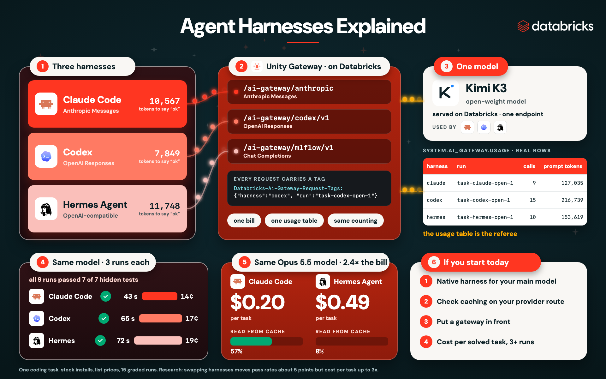
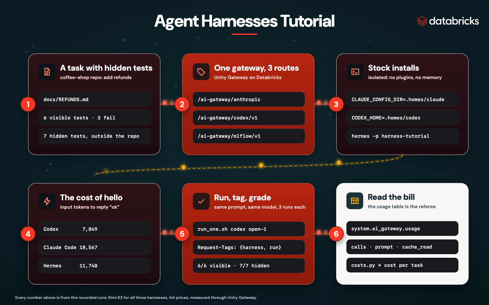
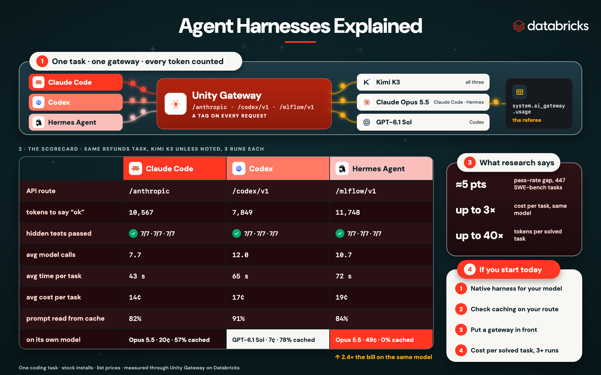

# Agent Harnesses Tutorial: Claude Code vs Codex vs Hermes on One Model

The companion code for the video **Compare Claude Code, Codex and Hermes on One Model with Unity Gateway** (link: _add your YouTube URL_).

Three coding agents get the same task on the same model, through one gateway, and every token is counted the same way.
All three get it right. What changes is how many tokens they send, how long they take, and what you pay.



## What a harness is

A **harness** is everything around the model: the loop that calls it again and again, the tools it can use, the
system prompt and context it sends, the memory it keeps, and the permissions on what it may touch. The model decides
what to do. The harness decides what the model sees, and how many times you pay for it.

| Harness | Speaks | Adds |
|---|---|---|
| **Claude Code** (Anthropic) | Anthropic Messages API | sub-agents, hooks, skills, `CLAUDE.md` |
| **Codex CLI** (OpenAI, open source) | OpenAI Responses API | sandbox with the network off by default |
| **Hermes Agent** (Nous Research, open source) | any OpenAI-compatible API | its own memory and skills, updated as it works |

Research on SWE-bench Verified found that swapping harnesses moves pass rates by only about 5 points, but changes
cost per task by up to 3x, driven by the preamble each harness sends on every call, times the number of steps
([Liu & Han, 2026](https://arxiv.org/abs/2610.04433)).

## The six steps



## What's in this folder

| Path | What it is |
|---|---|
| `task/` | the coffee shop codebase the agents work on: `coffee_orders/`, the refunds spec in `docs/REFUNDS.md`, 6 visible tests |
| `hidden_tests/` | 7 tests the agents never see: rounding, partial refunds, unknown items, restocking, the command line |
| `scripts/setup.sh` | installs the three harnesses and points each one at its Unity Gateway route, in an isolated config home |
| `scripts/probe.sh` | the hello test: what each harness sends before any work |
| `scripts/run_one.sh` | one graded run: copy the task, run one harness, grade with visible and hidden tests |
| `scripts/run_all.sh` | the whole experiment, 3 runs per harness, on the shared model and on each harness's own model |
| `scripts/costs.py` | reads `system.ai_gateway.usage` and prices every run |
| `results/` | the numbers from the video |

## Prerequisites

- A Databricks workspace with **Unity Gateway** and its coding-agent routes ([get started with coding agents](https://docs.databricks.com/aws/en/ai-gateway/coding-agent-integration))
- Access to the models through the gateway: `system.ai.kimi-k3` (shared), `system.ai.claude-opus-5-5`, `system.ai.gpt-6-1-sol`
- The Databricks CLI, signed in: `databricks auth login --host https://<your-workspace>.cloud.databricks.com --profile DEFAULT`
- Node.js 20+ (Claude Code and Codex) and Python 3.11+
- A SQL warehouse, for reading the usage table in Step 6

## Step 1 · A task with hidden tests

```bash
git clone https://github.com/viktoriasemaan/data-engineering.git
cd "data-engineering/Agent Harnesses Tutorial"
cp .env.example .env          # set DATABRICKS_HOST, DATABRICKS_CONFIG_PROFILE, WAREHOUSE_ID
```

The task is `task/docs/REFUNDS.md`: add `Shop.refund()` to a small order system. A refund is the item's share of
what the customer actually paid (after the loyalty discount, with tax), rounded to cents, and a full refund must
equal what was paid exactly. Before any agent runs, 3 of the 6 visible tests fail:

```text
...FFF                                                   [100%]
3 failed, 3 passed in 0.01s
```

The 7 hidden tests live in `hidden_tests/`, outside the folder the agents work in, so no agent can read them.

## Step 2 · One gateway, three routes

Each harness keeps its own API, so Unity Gateway gives each one a route, and all three reach the same model:

| Harness | Route | API |
|---|---|---|
| Claude Code | `/ai-gateway/anthropic` | Anthropic Messages |
| Codex | `/ai-gateway/codex/v1` | OpenAI Responses |
| Hermes Agent | `/ai-gateway/mlflow/v1` | Chat Completions |

Every request carries a tag, so the usage table can tell the runs apart:

```text
Databricks-Ai-Gateway-Request-Tags: {"harness":"codex","tier":"open","run":"task-codex-open-1","mode":"task"}
```

## Step 3 · Stock installs, isolated

```bash
bash scripts/setup.sh
```

This installs Claude Code, Codex and Hermes Agent and writes one provider config for each, in a config home inside
this folder: `CLAUDE_CONFIG_DIR=.homes/claude`, `CODEX_HOME=.homes/codex`, and a fresh Hermes profile called
`harnesstutorial`. Your own settings, plugins, skills and memory are never used, and never changed, so the comparison
is fair. A small helper, `.homes/bin/gw-token`, asks the Databricks CLI for a short-lived token whenever a harness
needs one. No API key is written to any file.

> **Company laptop?** If your organization manages Claude Code (a `managed-settings.json` that disables bypass
> permissions mode), unattended runs will stop and wait for approval, and organization settings override the isolated
> config home. Run the experiment on a machine without managed settings. The video ran Claude Code and Codex on a clean
> Linux machine on Databricks, and Hermes in a fresh profile on a laptop.

## Step 4 · The cost of hello

```bash
bash scripts/probe.sh
python3 scripts/costs.py --mode probe
```

Each harness answers "Reply with exactly: ok" once. The prompt tokens it sends are its **preamble**: the system prompt
and the tool definitions, paid on every model call, not once:

| Harness | Prompt tokens to say "ok" |
|---|---|
| Codex | 7,849 |
| Claude Code | 10,567 |
| Hermes Agent | 11,748 |

## Step 5 · Run, tag, grade

```bash
bash scripts/run_one.sh codex open 1     # one run
bash scripts/run_all.sh 3                # everything: 3 runs per harness, shared model and own model
```

Every run gets the same prompt:

> Implement refunds as described in docs/REFUNDS.md. Run the tests with `.venv/bin/python -m pytest -q` until they all
> pass. Keep the change small and in the style of the code. End with a one-line summary.

Then it is graded the same way: the 6 visible tests, then the 7 hidden ones, plus the size of the change.
Each run appends one line to `results/runs.jsonl`:

```json
{"harness": "codex", "tier": "open", "run": "task-codex-open-1", "seconds": "65", "visible": "6 passed in 0.01s", "hidden": "7 passed in 0.01s", "diff": "3 files changed, 31 insertions(+), 1 deletion(-)"}
```

Run each pair at least 3 times. A single run proves little: on the same task, Codex ranged from 12 to 20 cents.

## Step 6 · Read the bill

```bash
pip install databricks-sdk
python3 scripts/costs.py
```

`costs.py` reads `system.ai_gateway.usage`, the gateway's own record of every request, and prices each run from its
new, cached and output tokens. The usage table can lag by a few minutes after a run. The results from the video:



- **Correctness was a tie.** All 15 graded runs passed every hidden test.
- **On Kimi K3**, Claude Code averaged 43 seconds and 14 cents, Codex 65 seconds and 17 cents, Hermes 72 seconds and 19 cents. The ranges overlap.
- **Caching is a harness feature.** On the same Claude Opus 5.5 model, Claude Code cost about 20 cents a task with 57% of its prompt read from cache. Hermes, through the chat completions route, read 0 tokens from cache and cost 49 cents: 2.4x the bill.
- **Price per token is not price per task.** Codex with GPT-6.1 Sol was the cheapest run of all at 7 cents.

Full tables: [`results/README.md`](./results/README.md).

## If you start today

1. **Use the native harness for the model you rely on most:** Claude Code for Claude, Codex for GPT. They're tuned together, and caching just works.
2. **Want one agent for any model, with memory across sessions?** Hermes is a strong pick. Check that caching works on your provider route first.
3. **Put a gateway in front.** One bill, one usage table, a tag on every run, and you can swap models without touching your tools.
4. **Measure on your own repo.** Point `task/` at a real task with hidden tests, run `run_all.sh`, and compare cost per solved task.

## Caveats

One task, 2 or 3 runs per pair, at list prices. Anthropic doesn't officially support non-Claude models in Claude Code.
Treat the numbers as a method, not a leaderboard.

## Clean up

```bash
rm -rf .homes runs results/runs.jsonl task/.venv
hermes profile delete harnesstutorial
```
