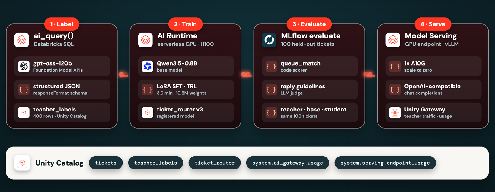
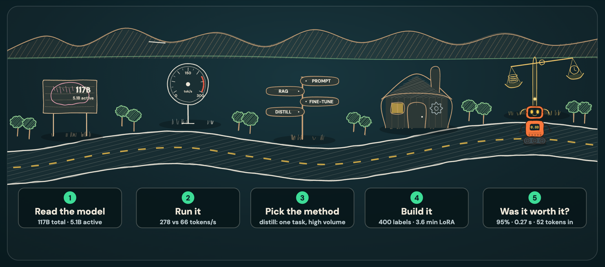

# LLM distillation on Databricks: teach a 0.8B model a 120B model's job

A big **teacher** model, OpenAI's gpt-oss-120b, labels 400 support tickets. A small **student**, Qwen3.5 0.8B, is
fine-tuned on those answers with LoRA, evaluated against both, and served on its own endpoint.
Everything runs in a Databricks workspace, in seven notebooks you run in order.

This is the code from the video **"LLM Distillation on Databricks"** on the Databricks YouTube channel.



The video follows five stops: read the model, run it, pick the method, build it, and decide whether it was worth it.



## What we got (Nov 14 2026, 100 held-out tickets)

| | Teacher · gpt-oss-120b | Base Qwen3.5 0.8B, prompted | Student · Qwen3.5 0.8B + LoRA |
|---|---|---|---|
| Parameters | 117B total, 5.1B active | 763M | 763M (10.8M trained, 1.42%) |
| Queue correct (code check) | 92–95% | 88% | **95%** |
| Good reply (LLM judge) | ~78% | ~20% | 58% |
| Input tokens per ticket | 541 | 541 | **52** |
| Median latency, one at a time | 0.77 s | | **0.27 s** |
| Cost | $0.18 per 1,000 tickets (pay-per-token) | | $1.40 per hour for 1× A10G · 26 tickets/s |

Break-even: about **7,900 tickets an hour**. Below that, the pay-per-token teacher costs less than keeping the
student's GPU on. Above it, the student wins. Your numbers will differ a little: the tickets are synthetic, the teacher
samples its answers, and the test has 100 tickets (each one is one point).

## The task

**Bean & Byte** is a made-up New York coffee chain with an ordering and delivery app. Every support ticket goes to one of
five queues (`delivery`, `billing`, `refund`, `account`, `app_bug`) with a one-to-two sentence reply, as JSON:

```json
{"queue": "delivery", "reply": "I'm sorry the two sandwiches were missing. I'll forward this to our delivery team right away."}
```

The queues and the routing rules (in priority order) are in `notebooks/_config.py`. The teacher and the base model get
all of them in every prompt (about 540 tokens). The student learns them in training, so its prompt is only the ticket.

## What you need

- A Databricks workspace on **AWS or Azure in a US region** (custom LLM serving is in Public Preview there), with
  Unity Catalog and serverless compute.
- **AI Runtime** (serverless GPU) with an **H100**, and the **AI v6** base environment.
- **Foundation Model APIs** pay-per-token access to `databricks-gpt-oss-120b` (teacher) and `databricks-qwen35-122b-a10b`
  (writes the tickets), plus `databricks-qwen3-next-80b-a3b-instruct` and `databricks-meta-llama-3-3-70b-instruct` for step 0.
- **Unity Gateway** access to `system.ai.gpt-oss-120b` (step 6).
- Permission to create a schema (or use one you own), tables, a volume, a registered model and a serving endpoint.

## Setup

1. In your workspace: **Workspace → Create → Git folder**, paste this repo's URL. (Or import the `notebooks/` folder.)
2. Open any notebook and set the `catalog` and `schema` widgets at the top (default `main.llm_distill`). Every notebook
   reads them through `%run ./_config`.

## The steps

| Notebook | Compute | Time | What you should see |
|---|---|---|---|
| `00_try_models` | serverless | 3 min | tokens per second: gpt-oss-120b ≈ 278, Qwen3-Next 80B A3B ≈ 225, Llama 3.3 70B ≈ 66. First token after 2K / 15K / 56K prompt tokens: 0.18 / 0.42 / 1.41 s. A repeated 56K prompt: ≈ 0.2 s once it's cached |
| `01_make_tickets` | serverless | 4 min | 60 `ai_query` calls write 600 tickets; 500 kept, 400 train / 100 test. Skip it with `data/tickets.csv` (last cell) |
| `02_teacher_labels` | serverless | 3 min | one SQL statement labels 400 tickets in ≈ 2.5 min, all valid JSON; teacher ≈ 92% on train and test |
| `03_finetune_student` | **AI Runtime, H100, AI v6** | 12–15 min | base model ≈ 88%; LoRA trains 10.8M of 763M parameters (1.42%) in ≈ 3.5 min; student ≈ 95%; registered as `ticket_router` |
| `04_evaluate` | serverless | 5 min | MLflow evaluation runs for teacher, base model and student: queue match + reply judge; every verdict in `eval_rows` |
| `05_serve_student` | serverless | up to 40 min (first deploy) | endpoint `ticket-router-student` (vLLM, 1× A10G, scale-to-zero) answers a ticket with JSON |
| `06_compare` | serverless | 10 min | 100 tickets each: latency, tokens, a 16-way burst, cost per 1,000 tickets and the break-even volume; the usage tables |
| `99_cleanup` | serverless | 1 min | deletes the endpoint, the model, the tables and the volume |

For step 3, choose in the notebook's compute menu: **Serverless GPU**, accelerator **H100**, base environment **AI v6**.
The student's serving endpoint scales to zero when idle; the first request after idle waits a few minutes.

## Things we learned the hard way

- **Write routing rules before you label anything.** Our first queue definitions overlapped (a double charge fit
  billing, refund and app_bug), so the answer key was inconsistent and the teacher looked worse than it was (86%).
  Rules in priority order fixed it (92%).
- **Train and serve with the same prompt, token for token.** Our first student answered with `<think>`: the prompt
  ended with `"Assistant: "`, and that trailing space is a token the model never saw in training. End the prompt with
  `Assistant:` and let the answer start with the space.
- **Check what the loss is computed on.** With TRL 0.24 and transformers 5.8, conversational prompt/completion rows
  produced a mask that also covered the prompt. Passing the prompt and completion as plain text fixed it; print
  `trainer.train_dataset[0]` and decode the `completion_mask` once.
- **Log and register the model from the GPU runtime.** Custom LLM serving needs the GPU dependencies packaged with the
  model (`env_pack="databricks_model_serving"`).
- **Qwen3.5 0.8B is the text half of a vision-language model.** Save it with the composite config and processor files,
  and start vLLM with `--limit-mm-per-prompt '{"image": 0, "video": 0}'` (all in notebook 03).
- **Unity Gateway routes to foundation models** (pay-per-token or provisioned throughput) and external models. A custom
  vLLM endpoint is called at `/serving-endpoints`, with usage tracking on the endpoint (`system.serving.endpoint_usage`).

## Learn more

- Serve custom LLMs with Model Serving (with Databricks' own fine-tune-and-serve notebook):
  https://docs.databricks.com/aws/en/machine-learning/model-serving/serve-custom-llms
- Fine-tune Qwen3.5-0.8B on AI Runtime and serve it:
  https://docs.databricks.com/aws/en/machine-learning/ai-runtime/examples/tutorials/sgc-finetune-qwen3.5-0.8b
- AI Runtime is Generally Available: https://www.databricks.com/blog/ai-runtime-generally-available
- Foundation Model APIs: https://docs.databricks.com/aws/en/machine-learning/foundation-model-apis
- Accelerating LLM inference with prompt caching for open-source models:
  https://www.databricks.com/blog/accelerating-llm-inference-prompt-caching-open-source-models-databricks
- Unity Gateway is Generally Available: https://www.databricks.com/blog/unity-ai-gateway-generally-available
- MLflow evaluation and judges: https://docs.databricks.com/aws/en/mlflow3/genai/eval-monitor/

The tickets in `data/tickets.csv` are synthetic, written by Qwen3.5 122B A10B. gpt-oss-120b and Qwen3.5 are released
under the Apache 2.0 license.
