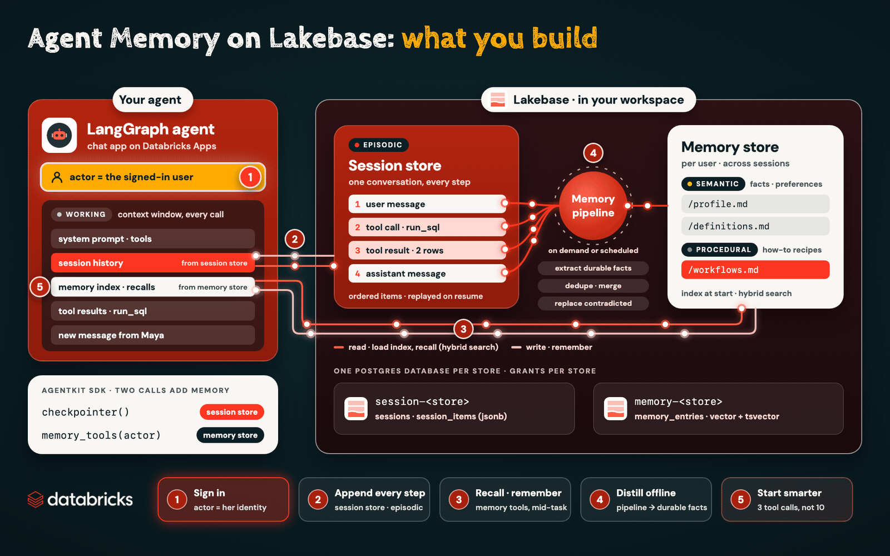
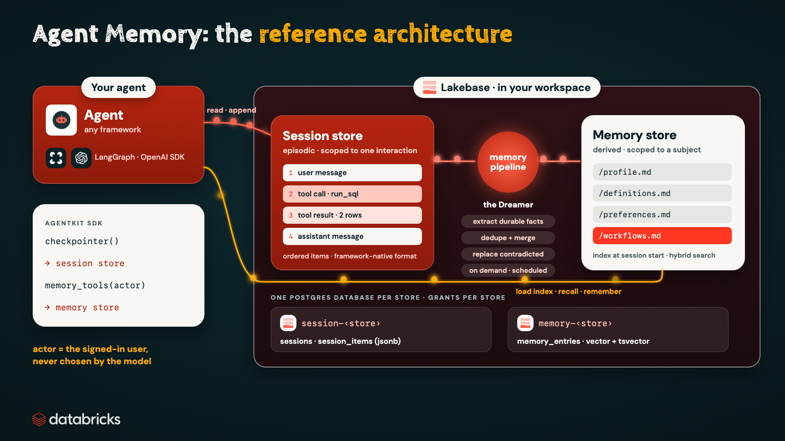
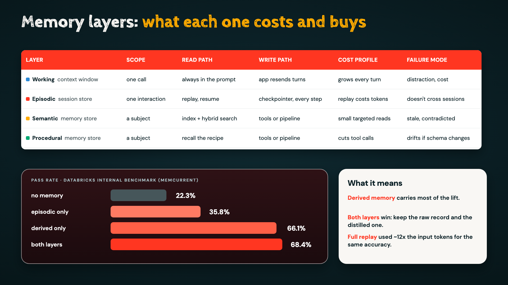
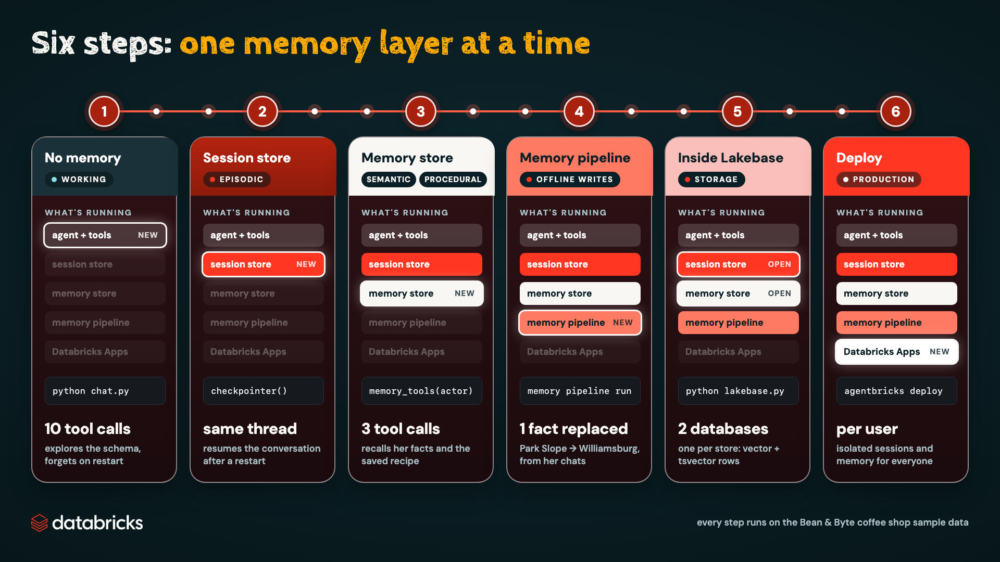

# Agent Memory on Databricks, step by step

The companion code for the video **Agent Memory on Databricks** (link: _add your YouTube URL_).
You build one agent and add each layer of state in turn: no memory, then a session store, then a memory store,
then a memory pipeline. Then you look at the Lakebase tables underneath, and deploy it to Databricks Apps.

It uses [Databricks Agent Memory (Beta)](https://www.databricks.com/blog/introducing-agent-memory-databricks).
Sessions and memories live in **Lakebase**, Databricks' serverless Postgres, in your workspace.



## What you'll build

Four types of memory, in two stores:

| Memory type | What it holds | Where it lives | Scope |
|---|---|---|---|
| **Working** | the context window for one model call | the prompt | one call |
| **Episodic** | every message, tool call and result, in order | session store | one conversation |
| **Semantic** | facts and preferences: her store, how her team defines weekly sales | memory store | one user, across conversations |
| **Procedural** | how-to recipes: the query that answers weekly sales | memory store | one user, across conversations |

How a turn uses them:

1. **Sign in.** The actor is the signed-in user's identity, never something the model chooses.
2. **Append every step.** The checkpointer writes each message, tool call and result to the session store.
3. **Recall and remember.** The agent loads the memory index at session start, searches memory (keyword and vector), and saves new facts with memory tools.
4. **Distill offline.** A memory pipeline reads past conversations, extracts durable facts, merges duplicates and replaces facts that changed.
5. **Start smarter.** The next conversation starts with what the agent knows: 3 tool calls instead of 10.

## The architecture in one paragraph



A **session store** keeps the raw record of one interaction: the ordered messages, tool calls and results.
That's episodic memory, scoped to one interaction. A **memory store** keeps the distilled record: durable facts,
preferences, domain knowledge and workflows. That's derived memory, scoped to a subject (the actor). At session
start the agent loads an index of what's known, then finds details with hybrid keyword and semantic search. A
**memory pipeline** reads sessions, extracts durable facts, removes duplicates and replaces facts that newer
conversations contradict. It runs on demand or on a schedule. Each store is its own Postgres database on a
Lakebase branch, and permissions are granted per store.



## What's in this folder

| Path | What it is |
|---|---|
| `agent/agent.py` | the LangGraph agent. Two calls add memory: `checkpointer()` (session store) and `memory_tools(actor)` (memory store) |
| `agent/tools.py` | three read-only tools over the sample database: `list_tables`, `describe_table`, `run_sql` |
| `agent/memory.py` | the memory index loaded at session start, and a transcript writer for memory pipelines |
| `chat.py` | terminal chat. It prints every tool call, then tool calls, input tokens and seconds per turn |
| `history.py` | reads a conversation back from the session store |
| `lakebase.py` | a read-only look at the Postgres tables behind the stores |
| `dreamer.md` | instructions that steer the memory pipeline |
| `data/make_data.py` | builds the Bean & Byte sample database (89,224 point-of-sale transactions, 7 stores) |
| `notebooks/agent_memory_walkthrough.ipynb` | the same ideas with the SDK directly, with saved outputs |
| `app/` | the deployable version (Step 6), scaffolded with `agentbricks init` |
| `scripts/cleanup.py` | deletes every store and pipeline the walkthrough created |

## Prerequisites

- A Databricks workspace with **Agent Memory (Beta)** enabled
- The Databricks CLI, signed in: `databricks auth login --profile <name>`
- Python 3.11 or later
- Access to a `system.ai` chat model through the AI Gateway. The default is `system.ai.claude-sonnet-5-5`; change `MODEL` in `agent/agent.py`.

## Setup

```bash
git clone https://github.com/viktoriasemaan/data-engineering.git
cd "data-engineering/Lakebase Agent Memory Tutorial"
python -m venv .venv && source .venv/bin/activate
pip install -r requirements.txt
cp .env.example .env                      # set DATABRICKS_CONFIG_PROFILE
export DATABRICKS_CONFIG_PROFILE=<name>   # the agentbricks CLI reads this too
python data/make_data.py                  # also built automatically on first use
```

**The trap in the data:** sales (`S`), gift-card loads (`G`) and refunds (`R`) share one table, and sales come from
the counter, the app and delivery. The team's definition of weekly sales is counter and app sales only, and
nothing in the schema says so. An agent has to be told once, and then remember.

Store names must be unique, so replace `bean-byte-*` below with your own prefix.

## Six steps, one layer at a time



Each step adds one layer to the same agent, and `chat.py` prints the tool calls, input tokens and seconds per
turn, so you can see what each layer changes.

## Step 1 · No memory

```bash
python chat.py --session chat-1
```
> Hi, I'm Maya, I manage the Park Slope store. How did we do last week?

The agent explores the schema (about 10 tool calls) and guesses the definition. Correct it:
> Close, but for us weekly sales means sale transactions from the counter and the app only. Gift cards,
> refunds and delivery are reported separately. And keep it short: one small table, last week vs the week before.

Exit and restart with the same `--session`. It no longer knows her store, because the default checkpointer is
in-process.

## Step 2 · Session store: the episodic layer

```bash
agentbricks sessions stores create --name bean-byte-sessions
export AGENT_SESSION_STORE=bean-byte-sessions
python chat.py --session chat-2        # ask, exit, restart with the same --session, ask a follow-up
python history.py --session chat-2     # every message, tool call and result that was saved
python chat.py --session chat-3        # a new conversation starts empty
```
Each LangGraph checkpoint is serialized into ordered session items and written through the session store API.
Sessions give continuity, not personalization, and the replayed history grows with the conversation.

## Step 3 · Memory store: the derived layer

```bash
agentbricks memory stores create --display-name bean-byte-memory
export AGENT_MEMORY_STORE=bean-byte-memory
python chat.py --session chat-4        # introduce yourself and the definition, then: "Perfect, remember how you worked it out"
agentbricks memory entries list --store bean-byte-memory --actor-id maya
python chat.py --session chat-5        # recall, then the saved recipe: 3 tool calls instead of 10
python chat.py --user devon --session chat-6   # another actor sees none of Maya's memory
```
Facts like her store and the metric definition are semantic memory. The saved query recipe is procedural
memory, and that's what removes the schema re-exploration. The actor is captured inside the tools and never
offered to the model.

## Step 4 · Memory pipeline: the offline write path

```bash
agentbricks sessions stores create --name bean-byte-transcripts
export AGENT_TRANSCRIPT_STORE=bean-byte-transcripts   # plain user/assistant turns for the pipeline
export AGENT_MEMORY_WRITES=pipeline                   # the agent can recall, not remember
python chat.py --session chat-7
```
> Quick heads up: as of this week I run the Williamsburg store. Devon took over Park Slope. How did my store do last week?

Wait a minute (pipelines only read turns older than 60 seconds), then:
```bash
P=$(agentbricks -o json memory pipeline create \
    --memory-store bean-byte-memory \
    --session-store bean-byte-transcripts \
    --instructions @dreamer.md | jq -r .name)
R=$(agentbricks -o json memory pipeline run $P | jq -r .name)
agentbricks memory pipeline runs get $R            # about 2 minutes until SUCCEEDED
agentbricks memory entries search --store bean-byte-memory --actor-id maya --query "store"
python chat.py --session chat-8                    # uses Williamsburg now
```
Pipelines skip tool calls and LangGraph checkpoints, so `chat.py` logs plain transcripts to their own store.
Add `--trigger scheduled` to run about every 24 hours.

## Step 5 · Inside the stores on Lakebase

```bash
agentbricks memory stores get bean-byte-memory   # Storage: the Lakebase project and branch
python lakebase.py memories                      # one row per memory file, with an embedding and a full-text index
python lakebase.py sessions                      # sessions and their ordered items
```
The table layout is internal to the managed service and can change. Read it to learn, and build on the SDK.

## Step 6 · Deploy to Databricks Apps

`app/` is an `agentbricks init` project (databricks-agentbricks 0.9.0) with three changes: the Bean & Byte
tools in `app/agent/tools/coffee.py`, the sample database in `app/data/`, and a system prompt in
`app/agent/agent.py`.

```bash
cd app
# edit agent.toml: give [memory_store] and [session_store] your own unique names
python data/make_data.py                          # the app reads data/bean_byte.db
agentbricks deploy                                # creates both stores, grants the app's service principal, deploys
agentbricks deployments get agent-bricks-bean-byte-app
```
Open the app URL. The runtime namespaces sessions and actors by the signed-in user, so everyone who signs in
gets isolated sessions and memory. Traces go to MLflow by default.

To start from scratch instead: `agentbricks init my-agent`, then copy in `coffee.py`, the data and the prompt.

## Production practices

1. Take the actor from the authenticated identity, never from model output.
2. Treat a store as a security boundary: one store pair per tenant, and grant access per store.
3. Use both layers: sessions for in-interaction state, memory for what matters in a future conversation.
4. Curate with a pipeline and steer it with instructions. Use online writes for facts the user states explicitly.
5. Plan for deletion: deleting a session doesn't delete memory derived from it. Delete entries per user to forget.
6. Measure pass rate, tool calls and input tokens per task from your traces.

## Clean up

```bash
python scripts/cleanup.py                                    # bean-byte-* pipelines, memory store and session stores
agentbricks deployments delete agent-bricks-bean-byte-app    # if you deployed Step 6
```

## Learn more

- [Introducing Agent Memory on Databricks](https://www.databricks.com/blog/introducing-agent-memory-databricks)
- [Stateful agents](https://docs.databricks.com/aws/en/agents/custom-agents/stateful-agents)
- [MemCurrent: designing persistent memory for production agents](https://www.databricks.com/blog/memcurrent-designing-persistent-memory-production-agents)

Agent Memory and the `agentbricks` CLI are in Beta. Commands and APIs can change; this repo pins
`databricks-agentbricks==0.9.0`.
