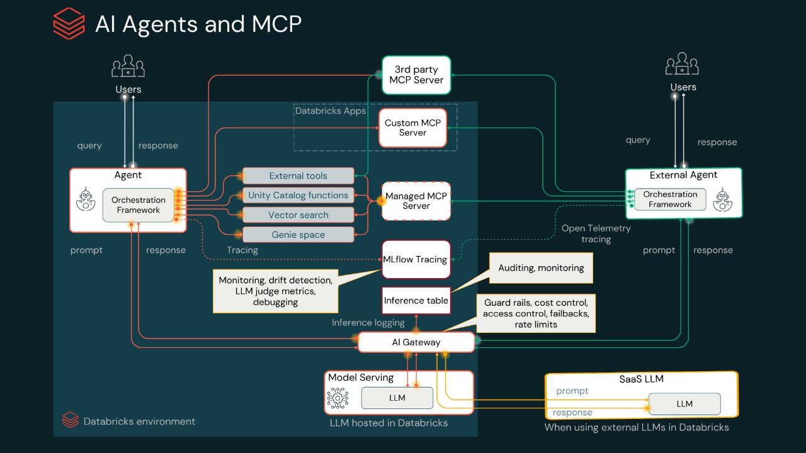

# 🚀 Data Engineering Portfolio

Real-world data engineering projects and tutorials covering Data & AI technologies, from your first lakehouse to AI agents that use tools and remember their users.

## Projects

The projects build on each other: a governed **lakehouse** holds the data, **AI agents** reach it through **MCP**, **agent memory** lets them learn each user over time, and the **agent harness** around the model decides how much each answer costs.

### 📊 [Lakehouse Tutorial](./lakehouse-tutorial/)
Your first complete data engineering project - build a production lakehouse from scratch using Apple Health data. Learn Spark, Delta Lake, and Unity Catalog fundamentals.

**Skills:** Medallion Architecture • Unity Catalog • Delta Lake • Apache Spark • SQL Optimization • Data Quality

### 🤖 [AI/BI Genie + Managed MCP Tutorial](./mcp-tutorials/)
An **AI agent** is an LLM that works in a loop: it reasons about a request, calls tools, reads the results and decides what to do next. **MCP (Model Context Protocol)** is the open standard that connects agents to those tools and data, so any MCP client, such as Claude Desktop, Cursor or your own agent, can use the same server. Databricks gives you three options: **managed** MCP servers for Genie spaces, Vector Search and Unity Catalog functions, **external** MCP servers from third parties, and **custom** MCP servers you host on Databricks Apps.

In this tutorial you set up AI/BI Genie and connect it to Claude Desktop through Managed MCP, so you can query your data in natural language.

**Skills:** AI/BI Genie • Managed MCP • Model Context Protocol • Claude Desktop • Natural Language Queries

### 🧠 [Lakebase Agent Memory Tutorial](./Lakebase%20Agent%20Memory%20Tutorial/)
An agent forgets everything between conversations unless you give it memory. Build a LangGraph agent step by step with Databricks Agent Memory: a **session store** for episodic memory (every message and tool call in a conversation), a **memory store** for semantic and procedural memory (each user's facts, preferences and how-to recipes), and a **memory pipeline** that distills past conversations into durable memories. Everything lives on Lakebase, and you deploy the agent as a Databricks App.

**Skills:** Agent Memory • Lakebase • Session & Memory Stores • Memory Pipelines • LangGraph • Databricks Apps

### ⚖️ [Agent Harnesses Tutorial](./Agent%20Harnesses%20Tutorial/)
A coding agent is a model plus a **harness**: the loop, the tools, the context, memory and permissions around it. Run **Claude Code**, **Codex** and **Hermes Agent** on the same task and the same model through **Unity Gateway**, grade every run with hidden tests, and read the bill from the gateway's usage table. All three get it right; on the same Claude Opus 5.5 model, one costs 2.4x another, because caching is a harness feature.

**Skills:** Agent Harnesses • Claude Code • Codex CLI • Hermes Agent • Unity Gateway • Prompt Caching • Cost per Task

*More projects coming soon...*

---

👋 **About:** This portfolio showcases hands-on data engineering and AI agent projects designed for practitioners and solutions architects to advance their knowledge in the data & AI space. Each project includes complete tutorials, sample data, architecture diagrams, and production-ready patterns.

⭐ **Star this repo** if you find it helpful for your data engineering journey!

## 📄 License

This project is licensed under the MIT License - see the [LICENSE](LICENSE) file for details.

---

## 🔗 Connect

Let’s stay in touch and keep learning together!

---

**Contributing:** Found a bug or have an improvement? Feel free to open an issue or submit a pull request!
