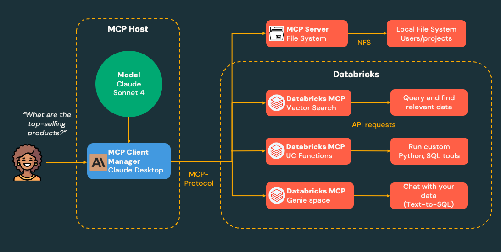

# 🚀 Data Engineering Portfolio

Real-world data engineering projects and tutorials covering Data & AI technologies.

## Projects

### 📊 [Lakehouse Tutorial](./lakehouse-tutorial/)
Your first complete data engineering project - build a production lakehouse from scratch using Apple Health data. Learn Spark, Delta Lake, and Unity Catalog fundamentals.

**Skills:** Medallion Architecture • Unity Catalog • Delta Lake • Apache Spark • SQL Optimization • Data Quality

### 🤖 [AI/BI Genie + Managed MCP Tutorial](./mcp-tutorials/)
Set up AI/BI Genie and connect it to Claude Desktop through Managed MCP, so you can query your data in natural language. Learn how Databricks' managed, external and custom MCP servers fit together.

**Skills:** AI/BI Genie • Managed MCP • Model Context Protocol • Claude Desktop • Natural Language Queries

### 🧠 [Lakebase Agent Memory Tutorial](./Lakebase%20Agent%20Memory%20Tutorial/)
Give an AI agent memory that survives restarts and follows each user across conversations. Build a LangGraph agent step by step with Databricks Agent Memory - session stores, memory stores and memory pipelines, all on Lakebase - then deploy it as a Databricks App.

**Skills:** Agent Memory • Lakebase • Session & Memory Stores • Memory Pipelines • LangGraph • Databricks Apps

*More projects coming soon...*

---

👋 **About:** This portfolio showcases hands-on data engineering projects designed for practitioners to advance their knowledge in the data & AI space. Each project includes complete tutorials, sample data, and production-ready patterns.

⭐ **Star this repo** if you find it helpful for your data engineering journey!

## 📄 License

This project is licensed under the MIT License - see the [LICENSE](LICENSE) file for details.

---

## 🔗 Connect

Let’s stay in touch and keep learning together!

---

**Contributing:** Found a bug or have an improvement? Feel free to open an issue or submit a pull request!
